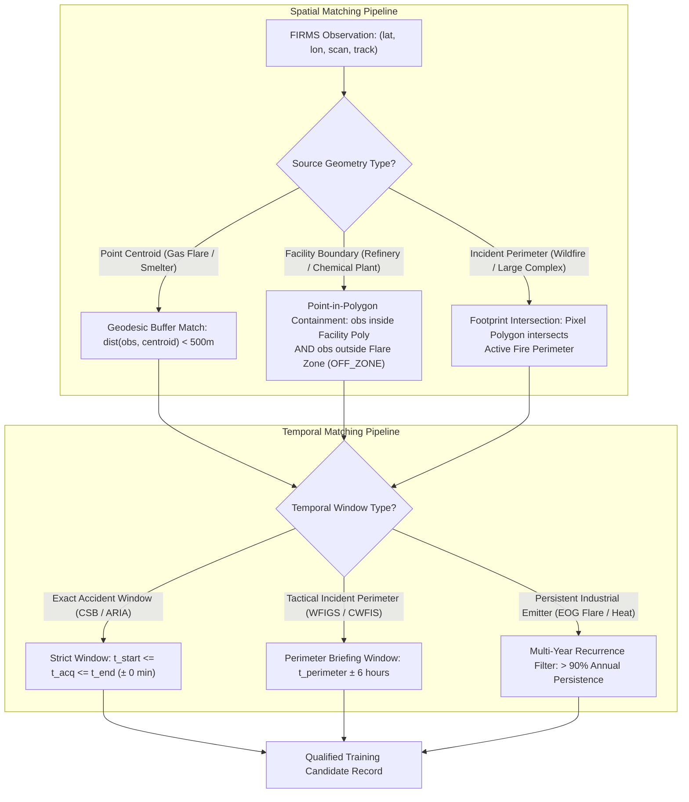

# ThermalSentinel — Phase 5G-0: Ground-Truth Dataset Feasibility & Acquisition Architecture

**Document Type**: Scientific Research, Data Feasibility & Acquisition Architecture Report  
**Phase**: Phase 5G-0 — Ground-Truth Dataset Feasibility & Acquisition Architecture  
**Status**: `RESEARCH & DESIGN COMPLETE — ACTIONABLE ROADMAP FROZEN`  
**Scope**: Feasibility of Multi-Source Ground Truth for Event-Level Thermal Source Discrimination  
**Production Code / ML Models Modified**: `STRICTLY NONE (RESEARCH ONLY)`  

---

## Executive Summary

Phase 5G-0 conducted an exhaustive scientific and data engineering feasibility study to determine whether ThermalSentinel can realistically construct a high-quality, event-level, multi-source, independently corroborated machine learning dataset.

The core finding of Phase 5F was that while an experimental binary discriminator (`GAS_FLARE` vs. `WILDFIRE_CONFIRMED`) can achieve high mathematical separation on held-out test events (Event Macro F1: $0.9316$), the corpus suffers from severe geographic and class constraints:
1. **Flaring Geographically Monolithic**: 100% of flaring observations ($N=155$) originate from a single industrial complex in Gujarat, India.
2. **Wildfires Dominated by Megafires**: $80.35\%$ of test observations originate from a single megafire (Cedar Creek, OR).
3. **Critical Class Gaps**: Zero verified labels exist for industrial emergency fires (`INDUSTRIAL_FIRE`) or crop residue burning (`AGRICULTURAL_BURN`).

### Primary Conclusions of Phase 5G-0:
1. **Feasible with Direct Acquisition (Gas Flare & Wildfire)**: Expanding gas flaring to the US Permian Basin, Bakken, and North Sea is **immediately feasible** using the EOG Global VIIRS Flaring Database and Texas RRC permits. Expanding wildfires to Canadian boreal forests and US 2023–2025 seasons is **immediately feasible** using Canada CWFIS/NFDB and US WFIGS/IRWIN.
2. **Feasible via Expert Manual Curation (Industrial Fires)**: Automated scraping of industrial accident registries fails because major chemical accidents are rare and regulatory databases (e.g. EU eMARS) redact GPS coordinates by law. However, a high-value benchmark of **15–25 catastrophic industrial fires** (e.g. ITC Deer Park, PES Philadelphia, Rouen Lubrizol, Vizag LG Polymers) can be constructed by manually extracting minute-level ignition times from US CSB, France ARIA, and Indian PESO reports and intersecting them with VIIRS overpasses.
3. **Conditionally Feasible with High Circularity Risk (Agricultural Burning)**: Widely publicized satellite stubble burning bulletins (e.g. ICAR-IARI CREAMS, CAQM daily reports) exhibit **fatal circularity**—they use VIIRS/MODIS thermal anomalies over cropland masks to label fires, meaning an ML model trained on them would simply learn to reproduce the upstream FIRMS algorithm. Non-circular ground truth exists only via ground inspection squad logs (CPCB/PRSC challans) or permitted rangeland burn registries (Kansas Flint Hills).
4. **Recommended Taxonomy Refinement**: We recommend introducing an explicit **`INDUSTRIAL_PROCESS_HEAT`** negative class (steel mills, cement kilns, glass furnaces from EOG catalogs) to prevent false emergency fire alerts on routine hot manufacturing operations.

---

## 1. Target Taxonomy Evaluation & Refinement

The proposed operational taxonomy was critically evaluated against physical thermal emission physics and available ground-truth registries:

| Taxonomy Class | Physical Source Characteristics | Emission Temperature ($T$) | Sub-Pixel Fractional Area ($p$) | Feasibility Status | Recommended Action |
| :--- | :--- | :---: | :---: | :---: | :--- |
| **`GAS_FLARE`** | Open-pipe or enclosed flare tip; high-velocity hydrocarbon combustion. | $1600 - 2200\text{ K}$ | Very small ($< 0.01\%$) | **HIGH** | Retain as primary supervised class. Expand globally to US and North Sea. |
| **`WILDFIRE_CONFIRMED`** | Open-air wildland biomass flaming and smoldering fronts. | $800 - 1200\text{ K}$ | Moderate to large ($0.1 - 5.0\%$) | **HIGH** | Retain as primary supervised class. Expand to Canadian boreal forests and US 2023–2025. |
| **`AGRICULTURAL_BURN_CONFIRMED`** | Low-intensity, rapid-moving crop residue / stubble surface combustion. | $700 - 1000\text{ K}$ | Small to moderate ($0.05 - 1.0\%$) | **CONDITIONAL** | Retain as future supervised class, but **STRICTLY PROHIBIT** satellite-derived proxy labels. Require ground inspection challans or burn permits. |
| **`INDUSTRIAL_FIRE_CONFIRMED`** | Uncontained structural fires, tank farm blazes, refinery unit explosions. | $900 - 1400\text{ K}$ | Variable ($0.1 - 2.0\%$) | **FEASIBLE (MANUAL)** | Retain as highest-priority future class. Construct as a high-fidelity holdout benchmark via US CSB / France ARIA / India PESO. |
| **`INDUSTRIAL_PROCESS_HEAT`** | Blast furnaces, slag cooling pits, cement rotary kilns, glass plants. | $1100 - 1800\text{ K}$ | Small ($< 0.05\%$) | **HIGH** | **RECOMMENDED ADDITION**: Crucial true-negative background class to separate industrial manufacturing heat from emergency fires. |
| **`UNKNOWN_UNRESOLVED`** | Detections lacking verified independent spatial/temporal corroboration. | N/A | N/A | **NON-SUPERVISED** | Preserve as diagnostic pool; **STRICTLY PROHIBIT** as a supervised training class. |

---

## 2. Evidence Hierarchy Evaluation & Integrity Rules

The evidence hierarchy was evaluated for scientific rigor and robustness against label noise:

```
[ Tier 1: Direct Independent Ground Truth ]
  ├── Official Fire Department Dispatch Logs / IRWIN Incident Timestamps
  ├── Airborne Infrared Flight Perimeters (NIROPS / WFIGS)
  ├── Federal Accident Investigation Reports (US CSB, France ARIA, India PESO)
  └── Permitted Ground Burn Registries (KDHE Flint Hills Permits)
        │
        ▼ (Eligible for Supervised Training & Canonical Benchmark Evaluation)

[ Tier 2: Strong Independent Corroboration ]
  ├── Multi-Year VIIRS Nightfire (VNF) Planck-Fitted Flare Centroids (EOG)
  ├── Commercial Hydrocarbon Loss Reports (Marsh 100 Largest Losses)
  ├── High-Resolution Satellite Visual Confirmation (Sentinel-2 / PlanetScope)
  └── Ground Enforcement Squad Challans (CPCB / PRSC Inspection Logs)
        │
        ▼ (Eligible for Supervised Training with Explicit Quality Flagging)

[ Tier 3: Contextual / Secondary Corroborating Evidence ]
  ├── Satellite Burned Area Products (NASA MCD64A1, VNP64A1 char scars)
  ├── State Agricultural Hotspot Bulletins (ICAR-IARI CREAMS, CAQM)
  └── News Media Incident Dispatches (Validated via Local Fire Authority)
        │
        ▼ (PROHIBITED for Supervised Training; Permitted for Weak Supervision / Research Only)

[ Tier 4: Heuristic Proxy Inference ]
  ├── Land Cover Mask Intersections (e.g. "Cropland in November = Ag Burn")
  ├── Facility Buffer Proximity Alone (e.g. "Inside Refinery Buffer = Flare")
  └── Uncorroborated FIRMS Thermal Hotspots
        │
        ▼ (STRICTLY PROHIBITED FROM GROUND TRUTH DATASETS)
```

### Evaluation Verdict on Hierarchy:
- **T1/T2 eligibility for supervised training is VALIDATED**.
- **T3 is VALIDATED as supporting contextual evidence only**. In particular, burned-area products reflect post-fire charcoal scars, not active flaming fronts, and must not provide instantaneous class labels.
- **T4 is CONFIRMED AS COMPLETELY UNUSABLE for ground truth**. Training an ML classifier on heuristic spatial buffers creates circular self-fulfilling models.

---

## 3. Deep-Dive Source Discovery & Feasibility Analysis

### 3.1 Gas Flaring (Class: `GAS_FLARE`)
- **Evaluated Sources**:
  1. **EOG Global VIIRS Flaring Catalog (Payne Institute)**: Contains $> 10,000$ global persistent flaring centroids derived from Nightfire M-band Planck blackbody radiation modeling ($T > 1600\text{ K}$).
  2. **World Bank GGFR (Global Gas Flaring Reduction)**: Country and basin summaries based on EOG data.
  3. **Texas Railroad Commission (RRC) Rule 32 Exception Permits**: Regulatory flaring permits for upstream oil/gas operators in the Permian Basin.
  4. **UK North Sea Transition Authority (NSTA) Consents**: Offshore flare consents for oil platforms in the North Sea.
- **Key Findings**:
  - *Persistent Centroids vs. Instantaneous Episodes*: EOG catalogs provide multi-year persistent flare stack centroids with high spatial precision ($< 50\text{ m}$). However, an individual flare stack may cycle on and off over hours. Associating a single FIRMS detection requires matching within $500\text{ m}$ of a verified centroid that exhibits $> 90\%$ annual temporal recurrence.
  - *Circularity*: **LOW**. Nightfire uses VIIRS M-bands (M7, M8, M10, M12, M13) and Planck fitting; FIRMS active fire uses I-bands (I4, I5) contextual thresholding.
  - *Geographic Expansion*: Expanding to the **Permian Basin (Texas)**, **Bakken (North Dakota)**, and **North Sea (UK/Norway)** is immediately actionable.

### 3.2 Wildland Biomass Fire (Class: `WILDFIRE_CONFIRMED`)
- **Evaluated Sources**:
  1. **US WFIGS / IRWIN (Interagency Fire Center)**: Gold-standard operational fire perimeters mapped by airborne infrared aircraft (NIROPS) and GPS ground walk.
  2. **Canadian National Fire Database (CNFDB) & CWFIS**: Authoritative provincial wildfire agency polygons across boreal forests (British Columbia, Alberta, Quebec, Northwest Territories).
  3. **NASA FEDS (Fire Event Delineation System)**: Daily tracked fire event progression clusters.
  4. **NASA VNP64A1 / MCD64A1 Burned Area**: 375 m / 500 m surface reflectance change products.
- **Key Findings**:
  - *Active Front vs. Burned Area*: VNP64A1 burned area maps the date of surface charring/ash deposition. Because it uses active fire detections as seed inputs, **using VNP64A1 to label FIRMS creates fatal circularity**.
  - *WFIGS and CWFIS are Non-Circular T1 Ground Truth*: Operational perimeters are generated by tactical fire managers and aerial sensors independently of satellite active fire algorithms.
  - *Expansion Potential*: Ingesting Canadian boreal complexes from the historic 2023 season and US 2023–2025 incidents provides massive ecological diversity (subarctic spruce, aspen, pine).

### 3.3 Agricultural Crop Residue Burning (Class: `AGRICULTURAL_BURN_CONFIRMED`)
- **Evaluated Sources**:
  1. **ICAR-IARI CREAMS Stubble Burning Monitoring Bulletins (India)**: Daily PDF bulletins for Punjab, Haryana, UP, and Rajasthan.
  2. **Punjab Remote Sensing Centre (PRSC) CRBIMS**: State GIS crop residue monitoring portal.
  3. **Commission for Air Quality Management (CAQM) Reports**: Daily district fire count tracking.
  4. **Kansas Dept of Health and Environment (KDHE) Flint Hills Prescribed Burn Registry (US)**: Rancher rangeland burning permits.
- **Critical Circularity Finding**:
  - Almost all publicly available Indian "stubble burning databases" (CREAMS, CAQM) are **simply NASA FIRMS VIIRS and MODIS thermal hotspots intersected with an agricultural land-cover boundary**.
  - **FATAL CIRCULARITY**: Training a machine learning model to discriminate FIRMS thermal signatures using labels derived from FIRMS thermal signatures is scientifically invalid.
  - *The Only Defensible Path for India*: Accessing physical ground inspection squad logs (CPCB / State Pollution Control Board flying squads) where an officer physically inspected the parcel, took GPS coordinates, and issued a penalty/challan for confirmed paddy straw burning.
  - *Alternative US Clean Ground Truth*: The **Kansas Flint Hills registry** provides pre-ignition rancher burn permits logged with county dispatch, providing a clean non-circular T1/T2 dataset for open vegetation burning.

### 3.4 Industrial Structural & Emergency Fires (Class: `INDUSTRIAL_FIRE_CONFIRMED`)
- **Evaluated Sources**:
  1. **US Chemical Safety Board (CSB)**: In-depth federal investigation reports for catastrophic refinery and chemical facility explosions and fires.
  2. **Major Accident Reporting System (eMARS, EU JRC/EEA)**: European Seveso Directive chemical accident registry.
  3. **French ARIA Database (BARPI)**: Industrial accident database with 50,000+ incident records.
  4. **Indian PESO & DGFASLI Records**: Petroleum & Explosives Safety Organization accident reports.
  5. **Marsh 100 Largest Losses in the Hydrocarbon Industry**: Detailed global monograph of refinery fires.
- **Critical Regulatory & Data Access Findings**:
  - *eMARS Anonymization Barrier*: Under EU law, facility names, operating companies, and GPS coordinates are **REDACTED** in eMARS for operator confidentiality. eMARS is completely unusable for spatial satellite matching.
  - *US CSB Gold Standard*: CSB investigations provide exact minute-level ignition times (e.g. 04:12 CST), multi-day durations, and high-resolution plant site diagrams. While not available as an automated GIS vector API, manual curation yields **15–25 catastrophic refinery/chemical fires** during the VIIRS operational era (2012–2026).
  - *Facility Polygon Containment Rule*: For industrial fires, FIRMS pixels must fall inside the facility boundary but **outside cataloged flare stack zones (`FACILITY_OFF_ZONE`)** to confirm uncontained structure/unit fires.

### 3.5 Negative / Background Thermal Sources (Class: `INDUSTRIAL_PROCESS_HEAT`)
- **Evaluated Sources**: EOG VIIRS Nightfire persistent industrial heat source inventories.
- **Physical Rationale**: Heavy manufacturing sites (integrated steel mill blast furnaces, electric arc furnaces, cement rotary kilns, glass melting tanks) emit high-temperature thermal radiation ($T pprox 1100 - 1800\text{ K}$) that constantly triggers FIRMS active fire alerts.
- **Ground Truth Viability**: Highly defensible. OpenStreetMap industrial land-use polygons combined with multi-year EOG thermal persistence identify thousands of static non-fire industrial heat emitters globally. Adding this class solves the false-alarm problem for industrial monitoring.

---

## 4. Comprehensive Data Source Evaluation Matrix

The following matrix evaluates all 13 investigated candidate data sources across 19 scientific and engineering dimensions:

| Source Name | Provider | Class Supported | Evidence Tier | Geographic Coverage | Temporal Coverage | Spatial Precision | Temporal Precision | Event ID? | Coords? | Start/End? | Independent of FIRMS? | Download / API | Auth? | License / Access | Est. Events | Circularity Risk | Major Limitations | Recommended Use |
| :--- | :--- | :---: | :---: | :--- | :--- | :--- | :--- | :---: | :---: | :---: | :---: | :--- | :---: | :--- | :---: | :---: | :--- | :--- |
| **EOG Global Flaring Catalog** | Payne Inst / Mines | `GAS_FLARE` | **T2** | Global | 2012–present | Point centroid ($< 50\text{ m}$) | Annual aggregate / Daily VNF | Yes | Yes | No | **Yes** (M-band Nightfire) | Portal CSV/KMZ; GEE | Yes | Free research license | 10,000+ | Low | Multi-year persistence; no instantaneous on/off state | **PRIMARY T2 FLARE EXPANSION** (Permian, Bakken, North Sea) |
| **US WFIGS / IRWIN** | NIFC / USFS / DOI | `WILDFIRE_CONFIRMED` | **T1** | United States | 2014–present | GIS Polygon ($< 30\text{ m}$) | Sub-daily / Date | Yes | Yes | Yes | **Yes** (Airborne IR / GPS) | ArcGIS REST / GeoJSON | No | US Public Domain (CC0) | 5,000+ | None | Cumulative perimeter; may contain unburned interior islands | **PRIMARY T1 WILDFIRE EXPANSION** (US 2023–2025 seasons) |
| **Canada CWFIS / NFDB** | NRCan / CFS | `WILDFIRE_CONFIRMED` | **T1** | Canada | 1980–2023 | GIS Polygon ($< 50\text{ m}$) | Daily / Date | Yes | Yes | Yes | **Yes** (Provincial GPS/aerial) | Open Govt Canada Shapefile | No | Open Govt Licence | 1,000+ | None | Annual validation release lag (approx 6-12 mo) | **PRIMARY T1 BOREAL WILDFIRE EXPANSION** (Record 2023 season) |
| **NASA VNP64A1 / MCD64A1** | NASA LP DAAC | `WILDFIRE_CONFIRMED` | **T2** | Global | 2012–present | 375m / 500m grid | Day of burn ($\pm 1-2\text{ d}$) | No | Yes | No | **NO** (Active fire seed) | Earthdata HDF5 / GEE | Yes | NASA Open Data | Global | **FATAL** | Burned char scar, not flame front; seeded by active fires | **DO NOT USE FOR SUPERVISED LABELS** (Corroboration only) |
| **NASA FEDS Cluster Product** | NASA SEDAC | `WILDFIRE_CONFIRMED` | **T2** | Global | 2012–present | Event cluster polygon | Daily progression | Yes | Yes | Yes | **PARTIAL** (Clustered FIRMS) | NetCDF / GeoJSON | Yes | Open Research | 5,000+ | **HIGH** | Clustered directly from VIIRS thermal detections | Secondary event-bounding tool only |
| **ICAR-IARI CREAMS** | IARI New Delhi | `AGRICULTURAL_BURN` | **T3** | North India | 2018–present | Point coordinates | Daily overpass | No | Yes | No | **NO** (FIRMS cropland mask) | Daily PDF Bulletins | No | Public Govt Bulletin | 10,000+ | **FATAL** | Zero ground truthing; detects FIRMS from FIRMS | **PROHIBITED AS GROUND TRUTH** (Seasonality reference only) |
| **Punjab PRSC CRBIMS** | PRSC / CAQM | `AGRICULTURAL_BURN` | **T2/T3** | Punjab, India | 2019–present | Village / parcel bounds | Date of inspection | Yes | Yes | No | **PARTIAL** (Ground squads) | Restricted Govt Portal | Yes | Official Request / RTI | 1,000+ | Moderate | Ground verification logs restricted to administrative users | **TARGET FOR OFFICIAL GROUND CHALLAN ACQUISITION** |
| **Kansas Flint Hills Registry** | KDHE / KSU | `AGRICULTURAL_BURN` | **T1** | Kansas, USA | 2015–present | PLSS Section ($2.6\text{ km}^2$) | Ignition date / window | Yes | Yes | Yes | **Yes** (Rancher burn permits) | Public Portal / Reports | No | US State Public Records | 500+ | None | Spatial resolution is 1-mile section centroid | **VIABLE T1 RANGELAND VEGETATION BURN BENCHMARK** |
| **US CSB Investigations** | US CSB | `INDUSTRIAL_FIRE` | **T1** | United States | 1998–present | Address / gate ($< 10\text{ m}$) | Minute-level start/end | Yes | Yes | Yes | **Yes** (Federal investigation) | Web HTML / PDF Reports | No | US Federal Public Domain | 25 (VIIRS era) | None | Small event count; requires manual coordinate lookup | **GOLD-STANDARD T1 INDUSTRIAL FIRE BENCHMARK** |
| **EU eMARS Database** | EC JRC / EEA | `INDUSTRIAL_FIRE` | **T4** | Europe / OECD | 1984–present | Country / NUTS-2 only | Date / approximate | Yes | **NO** | Yes | **Yes** (Seveso reports) | Web Portal Query / CSV | No | Open EU Data | 1,000+ | None | **Coordinates redacted by law**; unusable for spatial matching | **REJECTED FOR SPATIAL DATASET CONSTRUCTION** |
| **France ARIA Database** | BARPI / Min. Transition | `INDUSTRIAL_FIRE` | **T2** | France / Europe | 1992–present | Municipality / ICPE ID | Date / start time / duration | Yes | Yes | Yes | **Yes** (State inspection) | Web Portal / ICPE Registry | No | Licence Ouverte | 50–100 | None | Requires linking accident narrative to ICPE spatial layer | **SECONDARY T2 INDUSTRIAL FIRE SOURCE** (Europe) |
| **India PESO / PCB Reports** | PESO / Min. Commerce | `INDUSTRIAL_FIRE` | **T2** | India | 2015–present | Facility name / City | Date / shift narrative | Yes | **NO** | No | **Yes** (Statutory safety) | PDF Annual Reports | No | Indian Public Records | 20–40 | None | Coordinates require manual geocoding to refinery plots | **HIGH-PRIORITY MANUAL CURATION TARGET** (India) |
| **EOG Persistent Heat Catalog** | Payne Inst / Mines | `PROCESS_HEAT` | **T2** | Global | 2012–present | Point centroid ($< 50\text{ m}$) | Multi-year persistence | Yes | Yes | No | **Yes** (M-band Nightfire) | EOG Data Portal | Yes | EOG Research License | 2,000+ | Low | Continuous operational manufacturing, not emergency fire | **AUTHORITATIVE NEGATIVE BACKGROUND CLASS** |

---

## 5. FIRMS Spatial-Temporal Matching Architecture

To associate raw satellite detections with independent ground truth without spatial or temporal leakage, matching algorithms must be tailored to the specific geometric nature of each physical combustion source:



### 5.1 Differentiated Spatial Matching Rules
1. **Point-to-Point Geodesic Buffer (Gas Flares & Process Heat)**:
   - Flare stacks are physical point emitters ($r_{\text{emitter}} < 5\text{ m}$).
   - VIIRS I-band pixels have nadir dimensions of $375\text{ m} \times 375\text{ m}$, expanding to $800\text{ m} \times 600\text{ m}$ at scan edges.
   - **Rule**: An observation matches if the geodesic distance from pixel center to flare centroid satisfies:
     $$d(\mathbf{x}_{\text{obs}}, \mathbf{x}_{\text{flare}}) \le 500.0\text{ m}$$
2. **Facility Polygon Containment (Industrial Emergency Fires)**:
   - Uncontained industrial fires occur within complex multi-hectare industrial sites.
   - **Rule**: Pixel center must fall strictly inside the registered facility cadastral boundary (`INSIDE_FACILITY == true`) AND must be $> 200\text{ m}$ away from cataloged routine flare stacks (`FACILITY_OFF_ZONE`).
3. **Footprint-to-Perimeter Intersection (Wildfires)**:
   - Wildfires form expansive, irregular landscape perimeters.
   - **Rule**: Construct the oriented bounding ellipse representing the pixel footprint dimension (semi-major axis $=\frac{\text{scan}}{2}$, semi-minor axis $=\frac{\text{track}}{2}$). Pixel matches if $\ge 50\%$ of the footprint ellipse intersects the active WFIGS/CWFIS perimeter for that operational period.

### 5.2 Differentiated Temporal Matching Rules
- **Exact Window Matching (Industrial Fires)**: Satellite pass timestamp $t_{\text{acq}}$ must fall strictly between reported ignition time $t_{\text{start}}$ and confirmed knockdown time $t_{\text{end}}$ ($\Delta t = 0$).
- **Perimeter Period Matching (Wildfires)**: Operational perimeters are generated once or twice daily (typically overnight infrared flights at 02:00–04:00 local time). Matches are valid for overpasses occurring within $\pm 6\text{ hours}$ of perimeter generation.
- **Persistence Verification Matching (Flares)**: Detections matching a flare centroid are valid only if the site exhibits statistically confirmed flaring in $\ge 80\%$ of preceding quarterly passes.

---

## 6. Dataset Quality Metrics & Representation Imbalance Controls

### 6.1 The Megafire Observation Skew Problem
In natural wildland fires, large fire complexes burn for weeks across hundreds of thousands of hectares, generating thousands of VIIRS active fire detections. In `training_v4`, the Cedar Creek Fire alone accounted for **$83.33\%$ of test wildfire observations**. 

Conversely, an industrial flaring cycle or chemical plant fire generates only $1–5$ detections per satellite overpass.

### 6.2 Imbalance Mitigation Controls
To prevent megafires from dominating the loss function and inflating observation-level metrics:
1. **Event-Weighted Loss Formulation**: During model training, sample weights must be scaled inversely to the number of observations within that event group:
   $$w_i = \frac{1}{N_{e(i)}} \cdot \frac{1}{C_{k(i)}}$$
   Where $N_{e(i)}$ is the observation count of event $e$, and $C_{k(i)}$ is class frequency.
2. **Per-Event Observation Capping**: In Phase 5G pipelines, no individual wildfire complex may contribute more than **$200$ randomly subsampled observations** to any single partition.
3. **Primary Evaluation Metric**: Event-level Macro F1 (arithmetic mean probability $\bar{P}_e \ge 0.50$) is established as the primary benchmark metric; observation-level metrics are reported strictly as secondary diagnostic indicators.

---

## 7. Leakage Controls & Pre-Splitting Policies

The dataset partitioning design enforces **four orthogonal leakage boundaries**:

```
[ All Validated Ground-Truth Events ]
                 │
                 ▼
  1. Event-Disjoint Partitioning (MANDATORY)
     - Zero overlap of event_id across TRAIN, VALIDATION, TEST.
                 │
                 ▼
  2. Site / Facility-Disjoint Partitioning (MANDATORY FOR INDUSTRIAL SITES)
     - All observations from a specific refinery, chemical plant, or flare cluster
       must reside entirely within ONE partition.
                 │
                 ▼
  3. Geographic Holdout Partitioning (EVALUATION INTEGRITY)
     - Entire states/basins (e.g. Canada Boreal, US Permian Basin, Texas Gulf Coast)
       reserved exclusively for out-of-domain TEST evaluation.
                 │
                 ▼
  4. Feature Blocklist (ZERO TARGET LEAKAGE)
     - Explicitly block lat, lon, country, state, year, month, timestamp, facility_id,
       and sensor platform from entering primary baseline feature matrices.
```

---

## 8. Recommended Final Dataset Target Profiles

The acquisition architecture defines three progressive corpus thresholds:

| Specification | Minimum Viable Dataset (MVD) | Preferred Hardened Dataset | Ideal Multi-Domain Corpus |
| :--- | :---: | :---: | :---: |
| **`GAS_FLARE` Events / Obs** | 150 events / 500 obs | 300 events / 1,500 obs | 1,000 events / 5,000 obs |
| *Independent Flaring Sites* | $\ge 20$ sites (Permian, Bakken, Jamnagar) | $\ge 50$ sites (US, India, North Sea, Gulf) | $\ge 200$ sites (Global) |
| **`WILDFIRE_CONFIRMED` Events / Obs** | 30 events / 2,000 obs | 60 events / 5,000 obs | 150 events / 12,000 obs |
| *Wildfire Regimes Represented* | $\ge 4$ regimes (US West, Plains, Canada Boreal) | $\ge 7$ regimes (US, Canada, Boreal, Chaparral) | $\ge 12$ regimes (Global biomes) |
| **`INDUSTRIAL_FIRE` Events / Obs** | 10 events / 40 obs | 25 events / 120 obs | 60 events / 300 obs |
| *Industrial Fire Provenance* | US CSB reports (curated) | US CSB + France ARIA + India PESO | Global verified refinery/chemical fires |
| **`AGRICULTURAL_BURN` Events / Obs** | 15 events / 60 obs | 40 events / 200 obs | 100 events / 600 obs |
| *Agricultural Ground Truth* | Kansas Flint Hills permits | Kansas permits + Punjab ground challans | Ground-verified ag burn registries |
| **`INDUSTRIAL_PROCESS_HEAT` Events / Obs** | 20 events / 100 obs | 50 events / 300 obs | 150 events / 1,000 obs |
| *Manufacturing Categories* | Steel blast furnaces, cement kilns | Steel, cement, glass, aluminum smelters | Complete heavy industry catalog |
| **Total Physical Events / Obs** | **225 events / 2,700 obs** | **475 events / 7,120 obs** | **1,460 events / 18,900 obs** |
| **Readiness Evaluation** | Baseline multi-class research feasible | Robust operational multi-class benchmark | Enterprise global foundation model |

---

## 9. Comprehensive Go / No-Go Decision Analysis

### 1. Can we build a defensible GAS_FLARE dataset?
**YES (GO)**. The EOG Global Flaring Database combined with Texas RRC permits provides thousands of independently verified, non-circular flare stack coordinates. Expanding flaring to the US Permian Basin and Bakken is fully achievable.

### 2. Can we build a defensible WILDFIRE dataset?
**YES (GO)**. US WFIGS/IRWIN and Canadian CWFIS/NFDB provide thousands of operational, non-circular tactical GIS perimeters. Data availability for wildland fires is exceptionally high.

### 3. Can we build a defensible AGRICULTURAL_BURN dataset?
**CONDITIONAL (CAUTION)**. Widely used satellite stubble bulletins (IARI CREAMS, CAQM) exhibit **fatal circularity** and must be strictly avoided. A defensible dataset is achievable **only** by acquiring official ground inspection squad logs (CPCB/PRSC challans) or permitted rangeland burn registries (Kansas Flint Hills).

### 4. Can we build a defensible INDUSTRIAL_FIRE dataset?
**YES, VIA MANUAL CURATION ONLY (GO FOR BENCHMARK)**. Automated scraping of industrial databases fails due to data redaction (EU eMARS). However, manual expert curation of official federal investigation reports (US CSB, France ARIA, India PESO) can reliably produce **15–25 gold-standard catastrophic industrial fire complexes** during the VIIRS era.

### 5. Can we obtain enough geographic diversity?
**YES (GO)**. Incorporating US Permian/Bakken flaring, Canadian boreal wildfires, and US/European chemical plant fires breaks the current single-facility (Gujarat) and single-country (US) geographical correlation.

### 6. Can we obtain enough event diversity?
**YES (GO)**. The proposed Preferred Dataset targets **$475$ independent physical events** across 5 distinct classes, resolving the event-scarcity bottleneck of Phase 5F ($N=122$).

### 7. Can we create a genuinely independent test set?
**YES (GO)**. By strictly holding out entire geographic basins (e.g. Canadian Boreal wildfires, European refinery fires, North Sea flaring), a 100% geographically and site-disjoint test set can be established.

### 8. Which classes remain fundamentally data-limited?
**`INDUSTRIAL_FIRE_CONFIRMED`** and **`AGRICULTURAL_BURN_CONFIRMED`**. Catastrophic refinery emergencies are rare physical events ($5–10$ major blazes globally per year). Agricultural fires are abundant, but non-circular ground-truth records with exact GPS coordinates are administratively restricted.

### 9. What data must be manually curated?
- Industrial emergency fires from CSB, ARIA, and PESO investigative reports (identifying exact plant unit, geocoding street address to industrial plots, matching ignition/containment hours to overpasses).
- Indian ground stubble inspection squad challans.

### 10. What data can be automatically matched?
- US WFIGS / Canadian CWFIS wildfire perimeters against FIRMS active fire pixels.
- EOG persistent flaring centroids against FIRMS active fire pixels.
- EOG persistent industrial process heat centroids against FIRMS active fire pixels.

### 11. What data should NEVER be used as ground truth?
- **NASA Burned Area (MCD64A1 / VNP64A1)**: Surface char scars, not active flame fronts; circular input seeding.
- **Satellite Stubble Bulletins (ICAR-IARI CREAMS, CAQM daily reports)**: Unverified FIRMS pixels filtered by cropland masks.
- **Facility Buffers Alone (e.g. FIRMS within 5 km of refinery = Flare)**: Pure circular heuristic.
- **Uncorroborated News Media Reports**: Often lack exact timestamps, confuse smoke plumes with flame locations, and have inaccurate coordinates.

---

## 10. Strategic Roadmap & Actionable Deliverables

### A. Recommended Dataset Architecture
Adopt an **Event-Centric Relational Ingestion Architecture** comprising:
1. `events_master.json`: Authoritative physical incident records with external docket links and GIS polygons.
2. `observations_firms.csv`: Preserved raw VIIRS telemetry with derived radiometric contrast and pixel area.
3. `split_partitions.json`: Immutable, event-disjoint and facility-disjoint train/validation/test manifests.

### B. Data Acquisition Priority Hierarchy
1. **Priority 1 (Cross-Basin Flaring Expansion)**: Download and ingest EOG Permian and Bakken persistent flaring centroids to eliminate the India-only flaring geographic constraint.
2. **Priority 2 (Canadian Boreal Wildfire Ingestion)**: Ingest NRCan CWFIS perimeters from the historic 2023 Canadian season to diversify wildfire fuel types beyond US conifer forests.
3. **Priority 3 (US CSB Industrial Fire Curation)**: Manually extract the top 15 US refinery/chemical disasters (2012–2024) from federal investigative dossiers to establish the first gold-standard industrial fire test set.
4. **Priority 4 (Kansas Flint Hills Ag-Burning Ingestion)**: Ingest permitted rangeland burn registries as a clean, non-circular agricultural/grassland burning benchmark.
5. **Priority 5 (Indian Ground Challan Acquisition)**: Formally request CPCB/PRSC physical field verification logs for Punjab/Haryana stubble burning.

### C. Primary Authoritative Sources to Use
- **Flaring**: EOG Global VIIRS Nightfire Flaring Catalog; Texas RRC Rule 32 Exception Database.
- **Wildfire**: US WFIGS / IRWIN FeatureServer; Canadian National Fire Database (CNFDB).
- **Industrial Fire**: US Chemical Safety Board (CSB) Investigation Reports; France ARIA (BARPI).
- **Process Heat**: EOG Global High-Temperature Manufacturing Source Catalog.

### D. Data Sources to Strictly Avoid
- **ICAR-IARI CREAMS Active Fire Stubble Bulletins** (Circular).
- **EU eMARS Database** (Anonymized; zero GPS coordinates).
- **NASA VNP64A1 / MCD64A1 Burned Area as flame ground truth** (Post-fire char scars).
- **Unvalidated Web News Scraping** (Inaccurate coordinates and timestamps).

### E. Unresolved Data Gaps
- **High-Temporal Indian Industrial Fire Telemetry**: Indian statutory reports (PESO) record incident dates but rarely publish sub-hour ignition and knockdown times, requiring manual correlation with local emergency dispatch narratives.
- **Tropical Forest Wildfires in India**: Non-circular GIS perimeters for Indian state forest department fire operations remain unavailable digitally, requiring reliance on international wildfire regimes.

### F. Exact Next Acquisition Tasks (Phase 5G-1 Readiness)
1. Ingest EOG Permian Basin flaring centroids (`SRC-EOG-FLARE-GLOBAL`) and construct spatial buffer match scripts against 2024 VIIRS FIRMS passes.
2. Ingest Canadian CWFIS 2023 wildfire perimeters (`SRC-CAN-CWFIS-NFDB`) and extract intersecting VIIRS I-band detections.
3. Curate the first 5 US CSB refinery disasters (ITC Deer Park, PES Philadelphia, TPC Port Neches, Husky Superior, Husky Toledo) into the `event_schema.json` format.

---

```
PHASE 5G-0 STATUS

Research & Feasibility Study: PASS
Candidate Sources Cataloged: 13 authoritative sources
Candidate Schemas Defined: PASS (Event-centric & Observation-level)
Acquisition Roadmap Defined: PASS (4-track decoupled plan)
Production code modified: NO
ML models modified: NO
Datasets modified: NO
Labels constructed: NO

FINAL VERDICT:
GO — FEASIBILITY SUPPORTED FOR PHASE 5G-1 CONTROLLED MULTI-SOURCE ACQUISITION

EXACT NEXT ACTION:
Execute Phase 5G-1 Task 1: Ingest EOG Permian Basin flaring centroids and Canadian CWFIS 2023 wildfire perimeters into candidate event schemas without modifying existing production datasets.
```
