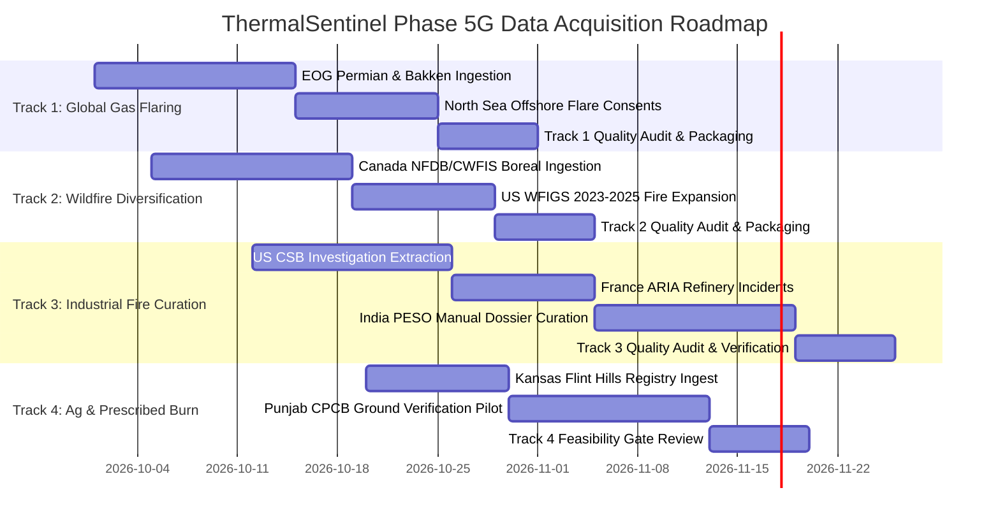

# ThermalSentinel — Phase 5G-0: Multi-Source Data Acquisition Plan

**Document Type**: Data Engineering Roadmap & Phased Execution Plan  
**Phase**: Phase 5G-0 — Ground-Truth Dataset Feasibility & Acquisition Architecture  
**Status**: `PROPOSED ROADMAP — READY FOR CONTROLLED EXECUTION`  
**Execution Strategy**: 4 Independent Thematic Acquisition Tracks  

---

## 1. Executive Acquisition Strategy

To transition ThermalSentinel from an India-flaring vs. US-wildfire experimental prototype into a robust multi-source thermal intelligence system, data acquisition must proceed along **four strictly decoupled, parallel tracks**. 

Each track targets a specific physical combustion class, enforces non-circular ground truth, and applies independent spatial-temporal matching rules.

---

## 2. Track Breakdown & Methodological Workflows

### Track 1: Cross-Basin Gas Flaring Diversification
- **Objective**: Eliminate the single-site geographic constraint (currently 100% Jamnagar, India) by acquiring verified flaring centroids across diverse geological basins and climatic regimes.
- **Primary Source**: EOG Global VIIRS Flaring Catalog (Payne Institute, Colorado School of Mines).
- **Secondary Corroboration**: Texas Railroad Commission (RRC) Rule 32 flaring exception permits; UK North Sea Transition Authority (NSTA) offshore flaring consents.
- **Target Basins**:
  1. **Permian Basin (Texas/New Mexico, USA)**: Semi-arid, high-density upstream associated gas flaring ($> 5,000$ active flare stacks).
  2. **Bakken Formation (North Dakota, USA)**: Continental subarctic winter, cold background flaring ($> 1,500$ active flare stacks).
  3. **North Sea (UK / Norway)**: Cold maritime offshore platform flaring (zero terrain/vegetation background).
- **Matching Protocol**:
  - Filter EOG persistent flare centroids exhibiting $> 90\%$ annual flaring recurrence.
  - Construct 500 m radial buffer around flare stack coordinates.
  - Perform spatial point-in-polygon match against VIIRS I-band detections.
  - Enforce nighttime-only filter initially, expanding to daytime passes where high-resolution optical imagery confirms stack location.
- **Expected Yield**: $150–300$ independent flare physical event clusters; $1,500–3,000$ VIIRS observations.

---

### Track 2: North American & International Wildfire Diversification
- **Objective**: Expand wildfire event diversity beyond the 17 US complexes in `training_v4` to include international boreal forest regimes, grassland savannahs, and recent high-intensity fire seasons.
- **Primary Sources**:
  1. **WFIGS / IRWIN (United States)**: Expand to 2023, 2024, and 2025 fire seasons (e.g. Texas Panhandle Smokehouse Creek Fire 2024; California Park Fire 2024).
  2. **Canadian National Fire Database (CNFDB) & CWFIS (Canada)**: Ingest major boreal wildfire complexes from the record 2023 Canadian wildfire season across British Columbia, Alberta, Northwest Territories, and Quebec.
- **Matching Protocol**:
  - Ingest official daily infrared/GIS fire perimeters.
  - Spatial match: FIRMS observation footprint must be completely contained within (`containment == 'FULL'`) or within 200 m of the confirmed operational perimeter on that date.
  - Temporal match: Acquisition timestamp must fall between verified daily operational perimeter update timestamps ($\pm 6$ hours).
- **Expected Yield**: $30–50$ independent wildfire complexes; $4,000–8,000$ VIIRS observations.

---

### Track 3: High-Fidelity Industrial Fire Ground Truth Curation
- **Objective**: Construct the first scientifically defensible, non-flare industrial fire benchmark dataset in satellite remote sensing history.
- **Methodological Challenge**: Catastrophic industrial fires occur infrequently and are rarely distributed in open GIS vector files. Automated scraping produces high noise. Therefore, Track 3 relies on **expert manual curation**.
- **Target Incidents & Primary Sources**:
  1. **US Chemical Safety Board (CSB) Reports**:
     - *Deer Park, TX (Intercontinental Terminals Company chemical tank fire, March 2019)*: 15 chemical storage tanks burned over 4 days.
     - *Philadelphia Energy Solutions (PES) Refinery, PA (June 2019)*: HF alkylation unit explosion and massive hydrocarbon blaze.
     - *Port Neches, TX (TPC Group butadiene explosion, November 2019)*: Chemical processing unit disaster.
     - *Superior, WI (Husky Energy refinery fire, April 2018)*: FCC unit explosion and asphalt tank fire.
  2. **French ARIA Database / ICPE Registry**:
     - *Lubrizol / Normandie Logistique chemical warehouse fire, Rouen (September 2019)*: Major multi-day chemical fire.
     - Documented French refinery unit fires (Feyzin, Gonfreville).
  3. **Indian PESO / State PCB Formal Reports**:
     - *Vizag LG Polymers styrene release & fire (2020)*.
     - *ONGC Uran plant gas processing unit fire (September 2019)*.
     - *Dahej chemical manufacturing complex explosions/fires (2020–2022)*.
- **Matching Protocol**:
  - Exact facility boundary digitized from high-resolution satellite imagery or state cadastral maps.
  - Sub-hour incident ignition and containment timestamps extracted from official federal investigative reports.
  - Satellite overpasses during active blaze window queried from VIIRS archive.
  - Spatial filter: Detection must fall inside facility boundary but outside designated routine flare zones (`FACILITY_OFF_ZONE`).
- **Expected Yield**: $15–30$ physical industrial fire events; $60–150$ high-value VIIRS observations.

---

### Track 4: Non-Forest Vegetation & Prescribed Agricultural Burning Pilot
- **Objective**: Resolve the critical agricultural burning gap without circular satellite heuristics.
- **Primary Source 1 (US Prescribed Rangeland Burning)**:
  - Kansas Department of Health and Environment (KDHE) Flint Hills rangeland burning registry.
  - Ground-issued rancher burn permits logged with local fire dispatch prior to ignition.
  - Match FIRMS pixels against PLSS section centroids on permitted burn dates.
- **Primary Source 2 (India Ground Inspection Challans)**:
  - Acquire official CPCB / Punjab Remote Sensing Centre (PRSC) physical ground inspection squad logs.
  - Use only records where an on-site government inspection team documented field coordinates, crop stubble type (paddy/wheat), and physical burnt acreage.
  - Strictly reject unverified satellite thermal hotspot points from ICAR-IARI CREAMS bulletins.
- **Expected Yield**: $20–40$ confirmed agricultural/rangeland burning events; $80–250$ VIIRS observations.

---

## 3. Quality Acceptance Gates & Ingestion Criteria

Before any acquired observation is ingested into the candidate training corpus, it must satisfy all 5 **Phase 5G Acceptance Gates**:

| Gate # | Gate Name | Acceptance Criteria | Rejection Action |
| :---: | :--- | :--- | :--- |
| **Gate 1** | **Provable Independence** | Ground truth source must not utilize VIIRS I-band active fire algorithms as input. Must be an external operational, regulatory, or physically measured record. | Reject source immediately. Mark as `CIRCULAR_HEURISTIC`. |
| **Gate 2** | **Deterministic Spatial Association** | Observation center must fall within confirmed boundary polygon or within $< 500	ext{ m}$ of verified point emitter. | Drop observation from supervised training set. |
| **Gate 3** | **Exact Temporal Coincidence** | Overpass timestamp must fall strictly between confirmed incident start and containment times ($\pm 0$ min for point events; $\pm 6$ hrs for active wildfire perimeters). | Mark observation as `TEMPORALLY_UNCORROBORATED`. |
| **Gate 4** | **Radiometric Sanity** | $T_{	ext{I4}}, T_{	ext{I5}} \in [200, 380]	ext{ K}$, $	ext{FRP} \ge 0.0	ext{ MW}$, $	ext{scan} \ge 0.30	ext{ km}$, $	ext{track} \ge 0.30	ext{ km}$. Zero `NaN` or non-finite values. | Mark observation as `INVALID_INPUT`. |
| **Gate 5** | **Physical Event Grouping** | Must be assigned to a verified `event_id` and `site_id` with documented evidence citations. | Prohibit ingestion into partition matrix. |

---

## 4. Target Dataset Composition Scenarios

| Class Taxonomy | Minimum Viable Dataset (MVD) | Preferred Hardened Dataset | Ideal Multi-Domain Dataset |
| :--- | :---: | :---: | :---: |
| **GAS_FLARE** | 150 events / 20 sites / 500 obs | 300 events / 50 sites / 1,500 obs | 1,000 events / 200 sites / 5,000 obs |
| **WILDFIRE_CONFIRMED** | 30 events / 30 sites / 2,000 obs | 60 events / 60 sites / 5,000 obs | 150 events / 150 sites / 12,000 obs |
| **INDUSTRIAL_FIRE_CONFIRMED** | 10 events / 10 sites / 40 obs | 25 events / 25 sites / 120 obs | 60 events / 60 sites / 300 obs |
| **AGRICULTURAL_BURN_CONFIRMED**| 15 events / 15 sites / 60 obs | 40 events / 40 sites / 200 obs | 100 events / 100 sites / 600 obs |
| **INDUSTRIAL_PROCESS_HEAT (Negative)**| 20 events / 20 sites / 100 obs | 50 events / 50 sites / 300 obs | 150 events / 150 sites / 1,000 obs |
| **Total Events / Observations** | **225 events / 2,700 obs** | **475 events / 7,120 obs** | **1,460 events / 18,900 obs** |

---

## 5. Risk Assessment & Mitigation Matrix

| Identified Risk | Severity | Probability | Mitigation Strategy |
| :--- | :---: | :---: | :--- |
| **Extreme Scarcity of Industrial Fires** | **HIGH** | **HIGH** | Enforce manual curation of federal investigation registries (US CSB, France ARIA). Accept small event sample size ($N pprox 20$) as a dedicated holdout test set rather than forcing balanced training. |
| **Circularity in Agricultural Burning** | **HIGH** | **HIGH** | Strictly block satellite-derived stubble burning maps (IARI CREAMS, CAQM bulletins). Rely exclusively on ground inspection squad logs or permitted rangeland burn registries. |
| **Domain Confounding from Country of Origin** | **HIGH** | **MODERATE** | Enforce multi-basin flaring (Permian Basin, Bakken, North Sea) to break the India=Flare / US=Wildfire correlation. |
| **Observation Skew from Megafires** | **MODERATE** | **HIGH** | Enforce event-level aggregation ($ar{P}_e \ge 0.50$) as mandatory primary metric; cap observation weighting per incident complex during loss evaluation. |
