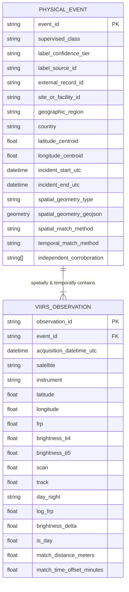

# ThermalSentinel — Phase 5G-0: Ground-Truth Data Schemas

**Document Type**: Data Engineering Schema Specification  
**Phase**: Phase 5G-0 — Ground-Truth Dataset Feasibility & Acquisition Architecture  
**Status**: `PROPOSED EXPERIMENTAL DATA SCHEMA`  
**Core Design Philosophy**: Event-Centric Partitioning & Multi-Scale Telemetry Retention  

---

## 1. Architectural Philosophy: Event as the Primary Splitting Unit

In satellite earth observation, machine learning datasets that partition individual pixel detections randomly suffer from catastrophic **spatial-temporal pseudo-replication and data leakage**. A single wildfire complex (e.g. Cedar Creek) produces thousands of spatially adjacent, temporally correlated VIIRS pixel detections over days. If rows are split at the observation level, the model memorizes the specific atmospheric plume, terrain background, and fire behavior of that single event, achieving artificial test scores that collapse upon deployment.

Therefore, the **Physical Event Group (`event_id`)** is the primary, indivisible unit of data modeling, quality control, and dataset partitioning.

---

## 2. Event-Centric Schema (`event_schema.json`)

Each record represents a discrete, physically verified combustion or heat-emission episode on the Earth's surface.

| Field Name | Type | Constraints / Allowed Values | Description |
| :--- | :---: | :---: | :--- |
| `event_id` | `string` | PK, e.g. `EVT-CSB-INDFIRE-US-TX-DEERPARK-20190317` | Canonical globally unique identifier for the physical event. |
| `supervised_class` | `string` | `GAS_FLARE`, `WILDFIRE_CONFIRMED`, `AGRICULTURAL_BURN_CONFIRMED`, `INDUSTRIAL_FIRE_CONFIRMED`, `INDUSTRIAL_PROCESS_HEAT`, `UNKNOWN_UNRESOLVED` | The verified physical combustion taxonomy class. |
| `label_confidence_tier` | `string` | `T1`, `T2`, `T3`, `T4` | Evidence strength tier per ThermalSentinel Evidence Hierarchy. |
| `label_source_id` | `string` | FK to Candidate Sources Catalog (e.g. `SRC-US-CSB-INVESTIGATIONS`) | The primary authoritative source provider. |
| `external_record_id` | `string` | e.g. `CSB-2019-02-I-TX`, `IRWIN-E7F2-4821-B33D` | Official case/incident identifier in the external agency's database. |
| `site_id` | `string` | e.g. `SITE-ITC-DEERPARK`, `SITE-JAMNAGAR-REF-01` | Unique persistent site or landholding identifier. |
| `facility_id` | `string` | Nullable, e.g. `FAC-RELIANCE-JAMNAGAR` | Link to registered ThermalSentinel industrial facility catalog if applicable. |
| `country` | `string` | ISO 3166-1 alpha-2, e.g. `US`, `IN`, `CA`, `GB` | Country of occurrence. |
| `geographic_region` | `string` | e.g. `US-TX`, `IN-GJ`, `CA-BC` | State, province, or administrative division code. |
| `latitude_centroid` | `float64` | $[-90.0, +90.0]$ | WGS84 latitude centroid of the physical incident. |
| `longitude_centroid`| `float64` | $[-180.0, +180.0]$ | WGS84 longitude centroid of the physical incident. |
| `incident_start_utc`| `datetime`| ISO 8601 UTC string, e.g. `2019-03-17T10:05:00Z` | Confirmed initial ignition or start time from dispatch/investigation records. |
| `incident_end_utc`  | `datetime`| ISO 8601 UTC string, e.g. `2019-03-20T18:00:00Z` | Confirmed containment, extinction, or episode cessation time. |
| `spatial_geometry_type` | `string` | `POINT_CENTROID`, `POLYGON_FACILITY_BOUNDARY`, `POLYGON_INCIDENT_PERIMETER`, `POLYGON_BURNED_AREA`, `GRID_SECTION` | Nature of the spatial geometry bounding the event. |
| `spatial_geometry_geojson` | `GeoJSON` | Valid GeoJSON Point or MultiPolygon | Exact GIS boundary representing the perimeter or facility extent. |
| `spatial_match_method` | `string` | `POINT_IN_POLYGON`, `GEODESIC_BUFFER_POINT_TO_POINT`, `FOOTPRINT_POLYGON_INTERSECTION` | Rule used to associate FIRMS pixels with this event. |
| `spatial_match_tolerance_meters` | `float64` | e.g. `500.0` (for point flares), `0.0` (for polygons) | Spatial threshold applied during matching. |
| `temporal_match_method` | `string` | `EXACT_INCIDENT_WINDOW`, `DAILY_CALENDAR_DATE`, `MULTI_YEAR_PERSISTENCE` | Rule used to associate overpasses in time. |
| `temporal_match_tolerance_hours` | `float64` | e.g. `0.0` (exact window), `12.0` (date expansion) | Buffer around start/end times. |
| `independent_corroboration` | `string[]` | URLs, report citations, agency docket numbers | Verifiable independent evidence artifacts. |
| `total_matched_observations` | `int32` | $\ge 1$ for training candidates | Count of associated VIIRS observations. |
| `firms_observation_ids` | `string[]` | Array of observation UUIDs | Cross-reference list of matched pixel records. |
| `notes` | `string` | Free text | Specific incident context, weather conditions, or data caveats. |

---

## 3. Observation-Level Schema (`observation_schema.json`)

Each record represents an individual satellite active fire detection pixel reported by NASA FIRMS, fully preserved with raw telemetry and derived analysis features.

### 3.1 Raw Satellite Telemetry Fields
| Field Name | Type | Units / Format | Physical Meaning |
| :--- | :---: | :---: | :--- |
| `observation_id` | `string` | PK, UUID v4 | Canonical unique observation identifier. |
| `event_id` | `string` | FK to `PHYSICAL_EVENT` | Parent event group link. |
| `latitude` | `float64` | Degrees WGS84 | Pixel center latitude. |
| `longitude` | `float64` | Degrees WGS84 | Pixel center longitude. |
| `acq_date` | `string` | `YYYY-MM-DD` | Date of acquisition. |
| `acq_time` | `string` | `HHMM` (UTC) | Time of overpass (UTC). |
| `acq_datetime_utc` | `datetime` | ISO 8601 UTC | Full timestamp. |
| `satellite` | `string` | `NOAA-20`, `SNPP`, `NOAA-21` | Satellite platform name. |
| `instrument` | `string` | `VIIRS` | Sensor payload. |
| `confidence` | `string` | `low`, `nominal`, `high` | Standard algorithm detection confidence. |
| `frp` | `float64` | MW | Fire Radiative Power calculated by MWIR radiance method. |
| `brightness_ti4` | `float64` | Kelvin | VIIRS Band I4 Midwave Infrared (3.74 μm) brightness temperature. |
| `brightness_ti5` | `float64` | Kelvin | VIIRS Band I5 Longwave Infrared (11.45 μm) brightness temperature. |
| `scan` | `float64` | km | Pixel cross-track spatial resolution footprint dimension ($0.32 - 0.80	ext{ km}$). |
| `track` | `float64` | km | Pixel along-track spatial resolution footprint dimension ($0.33 - 0.60	ext{ km}$). |
| `day_night` | `string` | `'D'` or `'N'` | Day or night observation flag. |
| `product_version` | `string` | e.g. `VNP14IMGTDL`, `VJ114IMGTDL` | NASA product stream identifier. |

### 3.2 Derived Mathematical Features
| Field Name | Type | Derivation Formula | Interpretation |
| :--- | :---: | :---: | :--- |
| `log_frp` | `float64` | $\ln(1 + 	ext{frp})$ | Non-linear compression of radiant intensity. |
| `brightness_delta` | `float64` | $T_{	ext{I4}} - T_{	ext{I5}}$ | Sub-pixel Planck spectral temperature contrast (K). |
| `is_day` | `float64` | $1.0$ if `'D'`, else $0.0$ | Numeric diurnal solar background flag. |
| `pixel_area_km2` | `float64` | $	ext{scan} 	imes 	ext{track}$ | Total ground surface area encompassed by the pixel ($0.11 - 0.48	ext{ km}^2$). |

### 3.3 Spatial & Temporal Match Telemetry
| Field Name | Type | Physical Meaning |
| :--- | :---: | :--- |
| `spatial_match_distance_meters` | `float64` | Geodesic distance from pixel center to event centroid or perimeter polygon edge. |
| `temporal_match_offset_minutes` | `float64` | Time difference between satellite overpass and confirmed incident active window. |
| `containment_status` | `string` | `INSIDE_POLYGON`, `BUFFER_PROXIMATE`, `CENTROID_MATCH`. |

### 3.4 Extended Future Research Candidates (Contextual Feature Pool)
These fields are preserved for ablation experiments and diagnostic modeling, but blocked from entering primary baseline models to prevent geographic and sensor confounding:
- `solar_zenith_angle`: Angle of the sun relative to the local zenith ($0^\circ - 180^\circ$).
- `sensor_view_zenith_angle`: Satellite viewing angle off-nadir ($0^\circ - 70^\circ$).
- `land_cover_copernicus`: Global 100 m discrete land cover classification code (e.g. 10=Cropland, 20=Forest, 50=Urban).
- `surface_elevation_meters`: Copernicus DEM 30 m ground elevation.
- `ambient_temperature_2m_k`: ERA5 reanalysis surface ambient air temperature at time of pass.
- `relative_humidity_pct`: ERA5 atmospheric moisture.
- `surface_wind_speed_ms`: ERA5 10 m wind velocity.
- `surface_wind_azimuth_deg`: ERA5 wind direction ($0^\circ - 360^\circ$).
- `dist_to_nearest_facility_km`: Distance to registered industrial infrastructure.
- `historical_pass_recurrence_rate`: Percentage of preceding 90 VIIRS passes exhibiting thermal anomalies at this coordinate.

---

## 4. Partition Splitting Invariant

To guarantee scientifically defensible generalization tests, the following invariant is enforced across all future training operations:

$$	ext{Partition}(	ext{Observation}_i) \equiv 	ext{Partition}(	ext{EventGroup}(	ext{Observation}_i))$$

$$orall e \in 	ext{Events}, \quad 	ext{Split}(e) \in \{	ext{TRAIN}, 	ext{VALIDATION}, 	ext{TEST}\}$$

$$	ext{TRAIN} \cap 	ext{VALIDATION} = \emptyset, \quad 	ext{TRAIN} \cap 	ext{TEST} = \emptyset, \quad 	ext{VALIDATION} \cap 	ext{TEST} = \emptyset$$

Under no circumstance may observations from the same physical event (or the same localized industrial site) be allocated to both training and evaluation splits.
