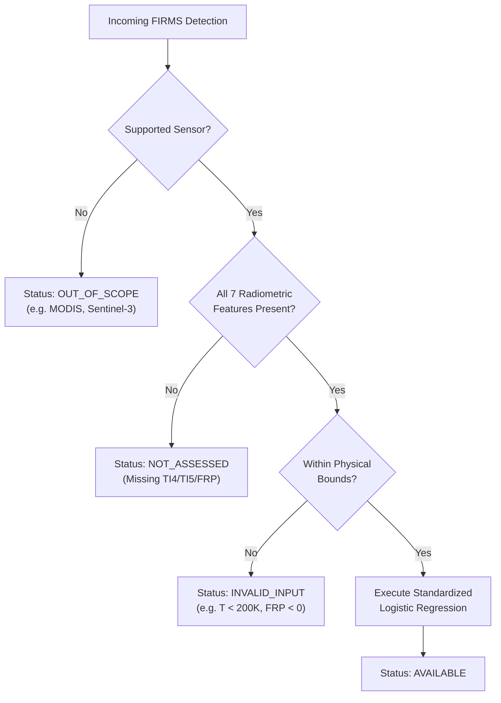
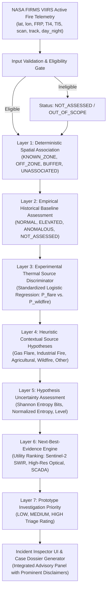

# ThermalSentinel — Phase 6.1: Experimental Advisory Integration Specification

**Document Type**: Engineering Architecture & Integration Specification  
**Phase**: Phase 6.1 — Experimental Advisory Integration Specification  
**Status**: `APPROVED SPECIFICATION — READY FOR IMPLEMENTATION REVIEW`  
**Model Architecture**: Standardized Logistic Regression ($L_2$, $C=1.0$, `class_weight='balanced'`)  
**Audited Artifacts**: Phase 5F.3 Hardening Baseline & Phase 5F.4 Independent Forensic Audit  
**Operational Role**: `STRICTLY ADVISORY EVIDENCE LAYER (LAYER 3) — NON-AUTHORITATIVE`  
**Production Code / Live APIs Modified in this Phase**: `NONE (SPECIFICATION ONLY)`  

---

## Executive Summary

This engineering specification governs the design and architectural boundaries for integrating the audited Phase 5F.3 **Standardized Logistic Regression Thermal Source Discriminator** into the ThermalSentinel investigation pipeline.

ThermalSentinel is an operational intelligence platform that ingests active thermal anomalies, evaluates deterministic spatial associations against industrial facility boundaries, compares observations against empirical historical baselines, quantifies hypothesis uncertainty, and prioritizes Next-Best-Evidence (NBE) acquisition.

The machine learning model evaluated in Phase 5F.3 is an **experimental binary discriminator** trained exclusively to differentiate between point-source industrial gas flaring (`GAS_FLARE`) and open-air wildland biomass fires (`WILDFIRE_CONFIRMED`). Under this specification, the model is integrated strictly as an **advisory evidence layer (Layer 3)**. It is granted **zero authority** to override deterministic spatial semantics, alter empirical baseline statuses, modify heuristic hypothesis rankings, or dictate operational investigation priorities.

---

## 1. Purpose & Architectural Principles

### 1.1 Purpose
The purpose of this integration is to provide an objective, radiometric likelihood signal ($P_{\text{flare}}$ vs. $P_{\text{wildfire}}$) derived from VIIRS midwave and longwave brightness temperatures, fire radiative power, and pixel geometry to assist human analysts during operational triage.

### 1.2 Core Architectural Principles
1. **Multi-Layered Defense-in-Depth**: The ML discriminator is one modular signal among seven analytical layers. It never acts as an autonomous decision-maker.
2. **Deterministic Primacy**: Spatial containment (facility polygons, flare stack coordinates) and empirical operational history always supersede statistical model predictions.
3. **Fail-Safe Degradation**: If model inputs are missing, invalid, or out-of-scope, the platform marks the discriminator status as `NOT_ASSESSED` and functions with zero degradation across all remaining diagnostic modules.
4. **Semantic Integrity**: Model scores must never be labeled or displayed as "fire probability", "incident probability", or "violation confidence". They are strictly defined as conditional model scores within the evaluated binary task.

---

## 2. Model Operational Scope & Prohibited Classes

### 2.1 Supported Binary Task
The model supports exactly one closed binary discrimination task:
- **Class 0 (`GAS_FLARE`)**: Point-source, high-temperature industrial hydrocarbon flaring ($T_{\text{emitter}} \ge 1600\text{ K}$, typical sub-pixel area $< 0.01\%$ of pixel footprint).
- **Class 1 (`WILDFIRE_CONFIRMED`)**: Landscape-scale wildland vegetative biomass combustion ($T_{\text{flame}} \approx 800-1200\text{ K}$, typical sub-pixel flaming/smoldering area $0.1-5\%$ of pixel footprint).

### 2.2 Explicitly Unsupported Combustion Classes
The following combustion classes are **UNSUPPORTED** by the supervised model and must be clearly labeled as such in all UI and API contracts:
- **`INDUSTRIAL_FIRE`**: Uncontained structural warehouse fires, petrochemical processing unit emergencies, crude distillation tower blazes, and storage tank fires.
- **`AGRICULTURAL_BURN`**: Open-field crop residue burning, stubble clearing, and sugarcane trash burning.
- **`OTHER`**: Mining smelters, municipal landfills, asphalt plants, and flare knock-out drum burn pits.

### 2.3 Semantic Mapping Guardrails
- **PROHIBITED**: Mapping `WILDFIRE_CONFIRMED` to "All Non-Flare Fires" or "General External Fire".
- **PROHIBITED**: Mapping `GAS_FLARE` to "All Industrial Thermal Activity".
- **REQUIRED**: Displaying the model output as a pairwise preference between flaring and wildfire vegetation combustion only.

---

## 3. Model Input Contract & Preprocessing Pipeline

### 3.1 Primary Candidate Input Vector
The model consumes an exact 7-dimensional vector of radiometric and sensor geometric parameters:

$$\mathbf{x} = [\text{log\_frp}, T_{\text{I4}}, T_{\text{I5}}, \Delta T, \text{scan}, \text{track}, \text{is\_day}]^T$$

| Feature Name | Data Type | Physical Definition | Expected Valid Range | Units | Missingness Policy |
| :--- | :---: | :--- | :---: | :---: | :--- |
| `log_frp` | `float64` | $\ln(1 + \text{frp})$, where $\text{frp}$ is Fire Radiative Power | $[0.0, 10.0]$ | $\ln(1 + \text{MW})$ | Reject observation if $\text{frp} < 0$ or null. |
| `brightness_ti4` | `float64` | VIIRS Band I4 Midwave Infrared (3.74 μm) brightness temperature | $[200.0, 380.0]$ | Kelvin (K) | Reject if null or outside sensor physical limits. |
| `brightness_ti5` | `float64` | VIIRS Band I5 Longwave Infrared (11.45 μm) brightness temperature | $[200.0, 380.0]$ | Kelvin (K) | Reject if null or outside sensor physical limits. |
| `brightness_delta` | `float64` | Midwave-to-longwave contrast ($T_{\text{I4}} - T_{\text{I5}}$) | $[-50.0, 150.0]$ | Kelvin (K) | Derived deterministically: $T_{\text{I4}} - T_{\text{I5}}$. |
| `scan` | `float64` | VIIRS pixel cross-track spatial resolution footprint | $[0.30, 0.90]$ | km | Reject if null or $< 0.30\text{ km}$. |
| `track` | `float64` | VIIRS pixel along-track spatial resolution footprint | $[0.30, 0.70]$ | km | Reject if null or $< 0.30\text{ km}$. |
| `is_day` | `float64` | Solar illumination flag: $1.0$ if `day_night == 'D'`, else $0.0$ | $\{0.0, 1.0\}$ | binary | Reject if null or unmapped. |

### 3.2 Feature Preprocessing & Normalization Contract
Standardization must utilize the frozen, training-derived parameter vectors:
$$\mathbf{z} = \frac{\mathbf{x} - \boldsymbol{\mu}_{\text{train}}}{\boldsymbol{\sigma}_{\text{train}}}$$

The frozen parameters fitted strictly on the Phase 5F TRAIN partition ($N=1,503$) are:
- $\boldsymbol{\mu}_{\text{train}} = [\mu_{\text{log\_frp}}, \mu_{\text{ti4}}, \mu_{\text{ti5}}, \mu_{\Delta T}, \mu_{\text{scan}}, \mu_{\text{track}}, \mu_{\text{is\_day}}]$
- $\boldsymbol{\sigma}_{\text{train}} = [\sigma_{\text{log\_frp}}, \sigma_{\text{ti4}}, \sigma_{\text{ti5}}, \sigma_{\Delta T}, \sigma_{\text{scan}}, \sigma_{\text{track}}, \sigma_{\text{is\_day}}]$

### 3.3 Strict Absence of Imputation
If any of the 7 features are missing, unparseable, or out of defensible bounds, the inference engine **MUST NOT** impute mean, median, or default values. It must immediately return `status: NOT_ASSESSED` with reason `MISSING_REQUIRED_INPUT`.

---

## 4. Model Artifact & Serialization Contract

### 4.1 Artifact Lineage & Provenance
To ensure total auditability, the model artifact must be packaged with explicit provenance metadata:
```json
{
  "artifact_metadata": {
    "model_name": "Standardized Logistic Regression Thermal Source Discriminator",
    "model_version": "lr-v5f3-standardized",
    "training_phase": "Phase 5F.3 Controlled Model Hardening",
    "audit_phase": "Phase 5F.4 Independent Forensic Audit (Verified)",
    "training_dataset": "ThermalSentinel-Training-Candidates-v4-Diverse",
    "training_date": "2026-09-11",
    "split_policy": "Strict Group-Preserved Event Partitioning (Zero Overlap)",
    "framework": "scikit-learn 1.9.1 / Python 3.12",
    "target_convention": {
      "class_0": "GAS_FLARE",
      "class_1": "WILDFIRE_CONFIRMED"
    }
  }
}
```

### 4.2 Mathematical Inference Formula
Inference is executed via standard regularized logistic regression:
$$z = w_0 + \sum_{j=1}^7 w_j \left( \frac{x_j - \mu_j}{\sigma_j} \right)$$
$$P(\text{Wildfire} \mid \mathbf{x}) = \frac{1}{1 + e^{-z}}$$
$$P(\text{Flare} \mid \mathbf{x}) = 1.0 - P(\text{Wildfire} \mid \mathbf{x})$$

Where frozen standardized weights from Phase 5F.3 are:
- $w_{\text{is\_day}} = +4.3430$
- $w_{\Delta T} = +4.4216$
- $w_{T_{\text{I4}}} = +2.1678$
- $w_{T_{\text{I5}}} = -2.5229$
- $w_{\text{track}} = +0.5018$
- $w_{\text{log\_frp}} = +0.5429$
- $w_{\text{scan}} = -0.0298$

---

## 5. Model Output Contract & JSON Schema

The output contract is formally defined by [`thermal_discriminator_schema.json`](file:///C:/Users/deepa/antigravity/ThermalSentinel/data/experiments/phase6_1_integration/thermal_discriminator_schema.json).

### 5.1 JSON Response Structure
```json
{
  "status": "AVAILABLE",
  "model_version": "lr-v5f3-standardized",
  "evaluation_level": "EVENT_AGGREGATE",
  "task": "GAS_FLARE_VS_WILDFIRE_CONFIRMED",
  "predicted_class": "GAS_FLARE",
  "wildfire_score": 0.1245,
  "flare_score": 0.8755,
  "decision_threshold": 0.50,
  "threshold_status": "EXPERIMENTAL_UNVALIDATED",
  "interpretation": "Advisory score favors GAS_FLARE over WILDFIRE_CONFIRMED based on sub-pixel spectral temperature contrast.",
  "evidence_basis": [
    "log_frp", "brightness_ti4", "brightness_ti5", "brightness_delta", "scan", "track", "is_day"
  ],
  "limitations": [
    "Evaluated binary task is GAS_FLARE vs. WILDFIRE_CONFIRMED only.",
    "Cannot evaluate INDUSTRIAL_FIRE or AGRICULTURAL_BURN.",
    "Score is not a calibrated real-world incident probability.",
    "Does not override spatial containment or empirical baseline."
  ],
  "timestamp": "2026-01-26T22:00:00Z"
}
```

---

## 6. Score Semantics & Operational Interpretation

### 6.1 Strict Score Definition
The score produced by the discriminator is:
> *"The model-estimated conditional probability that an observation resembles known wildland biomass fires versus known industrial gas flares, conditional upon the observation being one of those two specific classes."*

### 6.2 Prohibited Visual & Lexical Mappings
- **FORBIDDEN**: "78% Probability of Wildfire"
- **FORBIDDEN**: "88% Chance of Fire Incident"
- **FORBIDDEN**: "Violation Confidence Score: 0.85"
- **REQUIRED**: "Experimental Source Discriminator Score: 0.12 Wildfire / 0.88 Flare"

---

## 7. Decision Threshold Policy & Validation Gate

### 7.1 Separation of Experimental vs. Operational Thresholds
- **Experimental Threshold ($P = 0.50$)**: Applied during offline research evaluation.
- **Operational Threshold**: **NOT CURRENTLY VALIDATED**.

### 7.2 Explicit Policy Gate: `EXPERIMENTAL_UNVALIDATED`
The threshold $0.50$ must be explicitly tagged as `EXPERIMENTAL_UNVALIDATED` in all UI and API responses. Deploying an operational decision threshold (e.g. triggering an alert if $P_{\text{flare}} < 0.20$) requires a formal operational calibration study using ground-truth operational audits across multiple industrial facilities.

---

## 8. Observation-Level vs. Event-Level Evaluation

### 8.1 Observation-Level Scoring
Every raw FIRMS pixel detection passing the eligibility gate receives an observation-level score:
$$P_{i} = P(\text{Wildfire} \mid \mathbf{x}_i)$$

### 8.2 Event-Level Aggregation Protocol
When multiple detections occur within the same spatial-temporal event cluster $e$ ($N_e$ observations):
$$\bar{P}_e = \frac{1}{N_e} \sum_{i=1}^{N_e} P_i$$

### 8.3 Aggregation Status
The event-level mean aggregation is designated as the **"Experimental Event Aggregation Method"**. The case dossier must present both the event-aggregate score $\bar{P}_e$ and a summary distribution of the individual observation scores $P_i$ (min, median, max) to preserve visibility of sub-pixel variations.

---

## 9. Model Eligibility Gates & `NOT_ASSESSED` Rules

The integration pipeline must evaluate strict pre-flight gates before invoking model inference:



### 9.1 Supported Platforms
- `VIIRS-NOAA20` (VNP14IMGTDL / VJ114IMGTDL)
- `VIIRS-SNPP` (VNP14IMGTDL)
- *All MODIS platforms (`MODIS-Terra`, `MODIS-Aqua`) are marked `OUT_OF_SCOPE` because 1 km pixels and 4 μm channels are not calibrated to this model.*

---

## 10. Spatial Association Guardrail (Layer 1 Supremacy)

ThermalSentinel Layer 1 determines deterministic spatial association:
- `KNOWN_THERMAL_ZONE`: Located within cataloged flare stack or furnace buffer.
- `FACILITY_OFF_ZONE`: Located inside facility boundary, but outside known thermal zones.
- `FACILITY_BUFFER`: Located in peripheral buffer ($0-15\text{ km}$) surrounding the facility.
- `UNASSOCIATED`: Landscape observation unrelated to registered industrial infrastructure.

### Guardrail Invariants:
1. If spatial association is `KNOWN_THERMAL_ZONE`, a model prediction favoring `WILDFIRE_CONFIRMED` **CANNOT** reclassify the pixel as a wildfire. The system reports:
   > *"Spatial association confirms location inside cataloged flare stack zone. Experimental discriminator score suggests spectral characteristics resembling wildland fire, which may indicate atypical combustion or severe flare smoking. Physical site inspection recommended."*
2. If spatial association is `UNASSOCIATED` (e.g. 50 km into a national forest), a model prediction favoring `GAS_FLARE` **CANNOT** reclassify the fire as an industrial flare.

---

## 11. Behavioural Baseline Guardrail (Layer 2 Supremacy)

ThermalSentinel Layer 2 tracks empirical facility historical baselines:
- `NORMAL`: FRP and detection frequency within historical $p_{75}$ baseline.
- `ELEVATED`: FRP exceeds $p_{75}$ but within $p_{95}$.
- `ANOMALOUS`: FRP exceeds $p_{95}$ or occurs in previously inactive zones.
- `NOT_ASSESSED`: Insufficient historical baseline data ($< 30$ days).

### Guardrail Invariants:
- The ML discriminator **MUST NOT** alter the behavioural classification.
- An `ANOMALOUS` off-zone detection with a high `GAS_FLARE` score remains `ANOMALOUS`. The score simply indicates that the anomaly's spectral profile resembles high-temperature hydrocarbon combustion rather than wildland brush burning.

---

## 12. Heuristic Source Hypotheses Interaction (Layer 4)

ThermalSentinel Layer 4 maintains 5 heuristic contextual hypotheses:
- `GAS_FLARE`
- `INDUSTRIAL_FIRE`
- `AGRICULTURAL_BURN`
- `WILDFIRE_VEGETATION`
- `OTHER`

### Interaction Rules:
1. **No Direct Overwriting**: The ML score **DOES NOT** overwrite the normalized heuristic support distribution.
2. **Coexistence in Dossier**: The ML discriminator is displayed in a distinct sub-panel titled *"Experimental Radiometric Discriminator (Advisory)"*.
3. **Future Fusion Formulation**: Any future mathematical fusion (e.g. Bayesian updating) must be developed in a separate research phase and marked `EXPERIMENTAL_FUSION_UNVALIDATED`.

---

## 13. Uncertainty Assessment Interaction (Layer 5)

ThermalSentinel Layer 5 calculates normalized Shannon entropy across the 5 source hypotheses:
$$H = -\sum_{k=1}^5 p_k \log_2(p_k)$$

### Guardrail Invariants:
- The binary model probability $P(\text{Wildfire})$ **MUST NOT** be substituted into the 5-class Shannon entropy calculation.
- Binary model entropy $-[P\log_2 P + (1-P)\log_2(1-P)]$ must remain strictly internal to the discriminator diagnostic output if displayed.

---

## 14. Next-Best-Evidence (NBE) Integration (Layer 6)

Layer 6 ranks candidate sensory acquisitions to reduce hypothesis uncertainty.

### Operational Interaction:
The ML discriminator provides contextual evidence that modulates the **narrative explanation** of NBE recommendations:
- **Scenario**: Detection in `FACILITY_OFF_ZONE`.
- **Heuristic Hypotheses**: `GAS_FLARE` ($55\%$), `INDUSTRIAL_FIRE` ($35\%$).
- **ML Discriminator**: Favors `GAS_FLARE` ($88\%$) over `WILDFIRE_CONFIRMED` ($12\%$).
- **NBE Recommendation**: **Sentinel-2 SWIR Band 12 (20 m)**.
- **Generated Narrative**:
  > *"The experimental thermal discriminator provides supporting evidence that the thermal emission matches high-temperature gas flaring rather than vegetative wildfire. However, because the discriminator cannot differentiate routine flaring from an uncontained structural unit fire, Sentinel-2 SWIR imagery is prioritized to resolve sub-pixel flare stack containment."*

---

## 15. Investigation Priority Guardrail (Layer 7)

Prototype Investigation Priority (`LOW`, `MEDIUM`, `HIGH`) is calculated via deterministic operational triage rules based on spatial off-zone status and empirical FRP deviation.

### Guardrail Invariant:
- The ML discriminator score **MUST NOT** be included in the priority scoring formula in this initial integration.
- Priority is not decreased simply because the model predicts `GAS_FLARE`.
- Priority is not increased simply because the model predicts `WILDFIRE_CONFIRMED`.

---

## 16. User Interface Design & Inspector Presentation

The ThermalSentinel Incident Inspector shall incorporate a dedicated advisory card:

```
┌────────────────────────────────────────────────────────────────────────┐
│ EXPERIMENTAL THERMAL SOURCE DISCRIMINATOR [ADVISORY]                   │
├────────────────────────────────────────────────────────────────────────┤
│ Status: AVAILABLE             Model: lr-v5f3-standardized (Logistic)   │
│ Task:   GAS_FLARE vs. WILDFIRE_CONFIRMED                               │
├────────────────────────────────────────────────────────────────────────┤
│ Relative Source Likelihood (Evaluated Task Only):                      │
│                                                                        │
│   GAS_FLARE           ████████████████████░░░░░  82.4%                 │
│   WILDFIRE_CONFIRMED  ░░░░░                      17.6%                 │
│                                                                        │
│ Advisory Finding: Radiometric signature favors GAS_FLARE over          │
│ wildland biomass fire based on midwave-to-longwave contrast (ΔT=14.2K).│
├────────────────────────────────────────────────────────────────────────┤
│ [!] IMPORTANT ADVISORY NOTICES & LIMITATIONS                           │
│ • Binary Task Only: Does NOT assess INDUSTRIAL_FIRE or CROP BURNING.   │
│ • Non-Authoritative: Cannot override spatial facility containment.    │
│ • Conditional Score: Not a calibrated real-world incident probability. │
│ • Model Evidence Basis: log_frp, TI4, TI5, ΔT, scan, track, is_day.    │
└────────────────────────────────────────────────────────────────────────┘
```

---

## 17. Investigation Case Dossier Integration

The case dossier JSON structure is extended via the non-breaking property `thermalDiscriminator` as exemplified in [`case_dossier_extension_example.json`](file:///C:/Users/deepa/antigravity/ThermalSentinel/data/experiments/phase6_1_integration/case_dossier_extension_example.json).

If the model fails or is bypassed, `thermalDiscriminator.status` is set to `NOT_ASSESSED`, and all downstream dossier fields remain fully functional.

---

## 18. Failure, Fallback & Resilience Behavior

1. **Complete Decoupling**: If the ML runtime service throws an exception, times out, or encounters missing weights, the exception is caught, logged to telemetry, and converted to `status: NOT_ASSESSED`.
2. **Zero Cascade**: Under no circumstance shall an ML failure block case dossier generation, map rendering, spatial buffering, or priority alerting.
3. **No Phantom Predictions**: If the model fails, the system **NEVER** falls back to a default guess such as `OTHER` or `WILDFIRE`.

---

## 19. Model Versioning & Traceability Contract

Every generated case dossier must record:
1. `model_version`: e.g. `lr-v5f3-standardized`
2. `training_dataset_version`: e.g. `ThermalSentinel-Training-Candidates-v4-Diverse`
3. `feature_schema_version`: e.g. `v1.0.0`
4. `experiment_version`: e.g. `phase5f3-hardening`

Silent swapping or automatic retraining of the model without an explicit version increment is strictly prohibited.

---

## 20. Post-Integration Operational Monitoring Contract

Once implemented, telemetry must continuously log:
1. **Feature Distribution Drift**: Daily monitoring of mean $T_{\text{I4}}$, $T_{\text{I5}}$, $\Delta T$, and FRP across operational passes.
2. **`NOT_ASSESSED` Rate**: Percentage of incoming detections rejected at eligibility gates.
3. **Regional Climate Asymmetry**: Tracking inference volume across tropical vs. temperate geographic zones.
4. **Unsupported Source Flags**: User feedback flags indicating detections originated from agricultural or structural sources.
5. **Operational Verification Caveat**: Telemetry monitoring tracks system health and covariate drift; it **cannot establish ground-truth accuracy** without independently verified physical labels.

---

## 21. Preserved Limitations (Prominently Disclosed)

The platform must maintain permanent visibility of the following scientific constraints:
1. **Narrow Binary Task**: Evaluates point-source gas flaring vs. wildland biomass fires only.
2. **Geographic Flaring Scope**: Training flares originate exclusively from Gujarat, India. Cross-basin transfer (e.g. Permian Basin, Bakken, North Sea) remains unverified.
3. **Absent Industrial Fire Class**: Structural unit fires and chemical explosions are not represented.
4. **Absent Agricultural Class**: Stubble clearing and crop residue burning are not represented.
5. **Unequal Training Distribution**: Training data has unequal observation counts across physical events.

---

## 22. Strictly Prohibited Platform Behaviors

The ThermalSentinel integrated platform shall **NEVER**:
1. Declare a fire incident confirmed solely based on an ML score.
2. Declare a wildland fire within a facility boundary based on ML output.
3. Declare an environmental flaring violation based on ML output.
4. Trigger regulatory reporting or enforcement actions automatically.
5. Override deterministic facility boundary containment.
6. Suppress an operational off-zone investigation solely because the model favors `GAS_FLARE`.
7. Present the score as an unconditioned or calibrated probability of real-world fire.

---

## 23. Complete Multi-Layered Data-Flow Architecture



---

## 24. Integration Implementation Boundaries

| Component / Layer | Status in Codebase | Implementation Scope for Phase 6.2 |
| :--- | :---: | :--- |
| **NASA FIRMS Ingestion Engine** | `CURRENTLY IMPLEMENTED` | Existing live ingestion via `firmsService.ts`. |
| **Deterministic Spatial Association (Layer 1)** | `CURRENTLY IMPLEMENTED` | Existing polygon containment via `investigationService.ts`. |
| **Empirical Behavioural Assessment (Layer 2)** | `CURRENTLY IMPLEMENTED` | Existing historical baseline engine via `deviationEngine.ts`. |
| **Heuristic Source Hypotheses (Layer 4)** | `CURRENTLY IMPLEMENTED` | Existing 5-class contextual distribution. |
| **Uncertainty Engine (Layer 5)** | `CURRENTLY IMPLEMENTED` | Existing Shannon entropy quantification. |
| **Next-Best-Evidence Engine (Layer 6)** | `CURRENTLY IMPLEMENTED` | Existing candidate evidence ranking via `evidenceEngine.ts`. |
| **Investigation Priority (Layer 7)** | `CURRENTLY IMPLEMENTED` | Existing operational triage scoring. |
| **Standardized Logistic Regression Evaluator** | `DESIGNED (NOT IMPLEMENTED)` | Model inference service to be implemented in Phase 6.2. |
| **Advisory Case Dossier Schema Extension** | `DESIGNED (NOT IMPLEMENTED)` | Dossier TypeScript interface update in Phase 6.2. |
| **Advisory UI Inspector Card** | `DESIGNED (NOT IMPLEMENTED)` | UI component update in Phase 6.2. |
| **Multi-Class Supervised Foundation Model** | `FUTURE RESEARCH` | Subject to independent label acquisition for agricultural/structural fires. |
| **Bayesian Hypothesis Fusion Engine** | `FUTURE RESEARCH` | Subject to joint operational calibration study. |

---

## 25. Pre-Implementation Review Checklist

Before any production code is modified in Phase 6.2, engineering review must verify:
- [ ] Model inference is strictly advisory and non-authoritative.
- [ ] Prohibited classes (`INDUSTRIAL_FIRE`, `AGRICULTURAL_BURN`) are explicitly listed in UI/API contracts.
- [ ] Standardized model weights and scaler parameters match the audited Phase 5F.3 artifacts exactly.
- [ ] Missing inputs cleanly yield `NOT_ASSESSED` without crashing the investigation pipeline.
- [ ] No decision threshold is hardcoded as an operational alert trigger without explicit calibration.

---

```
PHASE 6.1 STATUS

Specification created: PASS
Production code modified: NO
Database modified: NO
Model retrained: NO
Threshold tuned: NO
New labels created: NO
Production integration implemented: NO

FINAL VERDICT:
A. INTEGRATION SPECIFICATION COMPLETE — READY FOR IMPLEMENTATION REVIEW

EXACT NEXT ACTION:
Conduct Phase 6.2 engineering implementation review of the Phase 6.1 specification before initiating any code integration.
```
